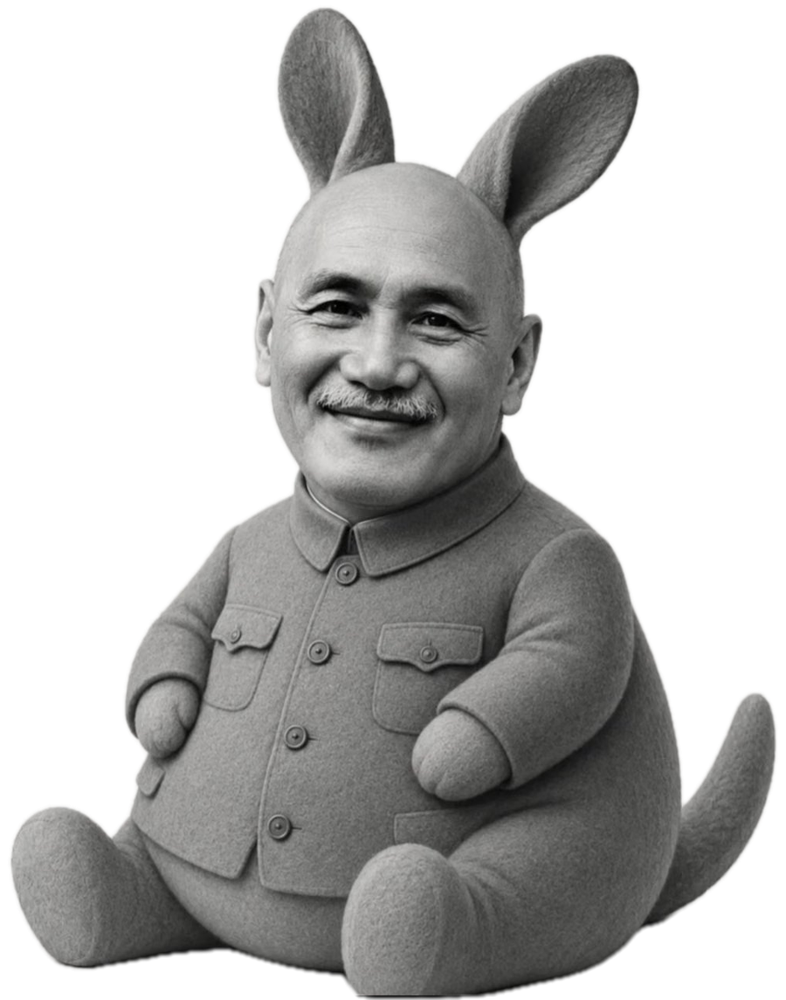

# 常凯申插件 · dsh-chang-kaishen

> 挂在 DSH 窗口边上的凯申显示器：金元券余额、经典台词，以及按时间逐步升级的捣乱。
> 最后一个循环结束时，它会抓一张当前屏幕，保持每个像素的颜色不变、只重新排列位置，逐渐“显影”出凯申的头像——点他一下，才能把屏幕要回来。

这是一个 **DeepSeek Harness（DSH）** 的桌面挂件插件，纯娱乐，不含任何混淆、隐藏图片或数据收集功能。



## 特性

- **像小鲸鱼一样挂在旁边**：整只 Q 版凯申直接贴在窗口上，**没有外框、没有常驻文字**；默认停在窗口左下角（避开右下角的小鲸鱼），可拖动、自动吸附边缘。平时它就是一张贴图，点击才弹出气泡。右键 / 长按打开 OSD 菜单。
- **金元券余额**：读取本机 DSH 已配置的 DeepSeek 余额（API Key 或 DSH 账号登录态），按 **1 元 = 10 亿金元券** 显示；余额只在气泡里出现，平时不占地方、也不显示人民币。
- **点按顺序（和小鲸鱼一样）**：点人物 → 气泡显示金元券余额；再点气泡 → 气泡变成一句经典台词；再点气泡 → 气泡消失，人物继续待着。气泡也可以由它自己主动冒出来。
- **按循环时长递进捣乱**：
  - 前 1/3：只在原地待机、冒泡；
  - 中间 2/3：随机出现中等事件——在屏幕上乱跑、挪到屏幕中间挡住你、像气球一样膨胀飘浮、飘金圆券、花园口决堤（黄色水流冲屏）；所有事件文字都会大号居中显示，没有文字框；
  - 循环最后：抓取当前屏幕，按《介石显示器》同一套算法重新排列像素（颜色一个都不改，只换位置），逐渐“显影”成显示器项目里的那张凯申人脸图，**点击凯申 Q 版才能打败他并还原屏幕**；
  - 还原后循环清零，从头开始。
- **捣乱开关**：菜单里可以一键关闭“捣乱模式”。关掉后它就老老实实待在边上，不捣乱、不出大乱；点它仍然可以看余额和台词。
- **循环时长可调**：默认 3 分钟，菜单可选 3 / 5 / 10 / 15 / 20 / 30 分钟。
- **支持作者**：菜单里有微信赞赏码，文案是“给作者的大肥鱼喂一点白饭吧，顺便给作者也买杯奶茶。”

## 安装

### 方式 A：让桌面端 DSH 自己装（推荐）

在桌面客户端里对 DSH 说：

> 把 `github:666666fine-png/dsh-chang-kaishen` 装上

安装完成后如果挂件没出现，重启一次 DSH 客户端。

本插件需要 **Web GUI 客户端**（Plugin Manager 会读 `dsh.client`）。桌面端和 Web 端都支持。

### 方式 B：Web 部署（`dsh web`）

```bash
dsh plugin --profile web add github:666666fine-png/dsh-chang-kaishen
```

如果已发布到 npm：

```bash
dsh plugin --profile web add dsh-chang-kaishen
```

### 方式 C：本地开发安装

```text
让 DSH 用 plugin_manager 安装本地目录：/绝对路径/chang-kaishen
```

替换已安装的包通常需要重启桌面端。

## 使用

- **点击挂件**：弹余额气泡；**点击气泡**：变成经典台词；**再点气泡**：气泡消失。捣乱中点击人物会先结束当前捣乱，再弹一句台词。
- **拖动挂件**：拖到任意位置，松手后吸附到最近边缘；拖拽不会误触菜单按钮。
- **右键 / 长按**：打开 OSD 菜单。
  - 捣乱开关：开 / 关（关掉后只待着，不捣乱）
  - 循环时长：3 / 5 / 10 / 15 / 20 / 30 分钟
  - 刷新金元券余额
  - 支持作者（微信赞赏码）
  - 汇率与说明
  - 关闭菜单
- **设置菜单不会因为改设置而关闭**：切换捣乱开关、改循环时长、刷新余额时菜单都留在原处；点菜单外或“关闭菜单”才收起。
- **主动冒泡**：待机超过约 45 秒，或随机在捣乱事件开始时，它会自己弹一个余额气泡；点气泡照常进入余额 → 台词 → 关闭的循环。
- **终极大乱**：循环结束时，插件会抓一张当前屏幕作为“照片”，用和《介石显示器》一样的算法重新排列像素——每个像素的颜色保持原样，只换位置，逐渐显影成显示器项目里的那张凯申人脸图；点击仍在屏幕上的凯申 Q 版即可打败他并还原，随后循环从 0 重新累计。若一直不点，60 秒后会自动撤退（安全兜底）。

### 台词语音？

没有，只有文字气泡。台词为固定 7 句：

- 优势在我！（《大决战》影视台词）
- 总座高见。（《大决战》影视台词）
- 我亲自部署、亲自指挥。（微操梗）
- 微操一下，问题不大。（微操梗）
- 运输大队长已就位。（历史戏称）
- 娘希匹！（已消音）（影视/粗口，弱化处理）
- 鼠标左移5毫米。（原创微操梗）

## 金元券汇率

主界面固定按 **1 元人民币 = 10 亿金元券** 显示。依据：

- 1949 年 5 月 27 日上海解放后，人民政府宣布金圆券作废，人民币与金圆券的收兑比价为 **10 万金圆券 = 1 元旧人民币**；
- 1955 年发行新人民币，**1 元新币 = 旧币 1 万元**；
- 因此折合：**1 元新币 = 10 亿金圆券**。

来源：光明网《解放初大上海的银币之战》、中国人民银行《忆金圆券回收和人民币的发行》。这是历史梗，不是真实金融换算。

## 它和《介石显示器》是同一套算法

- 源图：当前屏幕截图；目标图：Q 版凯申。
- 把源图和目标图都缩到多层网格，代价函数：
  `代价 = 颜色差² × 目标权重 + (位移² × 邻近重要度)²`
  人物权重高（255），背景权重低（12）。
- 先在最粗层（16×16）用匈牙利算法求全局最优；再逐层 32 → 64 → 128 上采样，用邻域随机交换继续优化。
- 最终画面里的**每个像素颜色都来自源图**，只改变像素的位置——所以看起来像目标照片，但颜色仍是你屏幕上的颜色。
- 播放时像素从原位置飞向目标位置，形成“显影”效果；这正是作者项目里的核心玩法。

## 隐私与安全

- 余额只从**本机 DSH** 的 DeepSeek 凭据或账号读取，**不上传、不写文件、不打日志**。
- 终极大乱会在**本机**用 macOS `screencapture` 抓一张当前屏幕作为源图（DSH 窗口本身受系统内容保护，通常抓到的是桌面/壁纸；如果系统拒绝录屏权限，则退回页面内渲染）。源图只在内存里参与像素重排，**不保存、不上传**。
- 像素重排完全在浏览器页面内完成；不读写剪贴板、不修改聊天内容、不拦截键鼠。
- 不读写剪贴板、不修改聊天内容、不拦截键鼠、不做任何“混淆/隐藏图片”功能。
- 唯一网络请求是查询 DeepSeek 余额接口（使用你本机已有的凭据）。
- 所有素材均为插件作者提供；没有影视截图、真实雕像照片或第三方版权图片。
- 捣乱只发生在 **DSH 窗口内**，不会覆盖整个 macOS 桌面。

## 目录结构

```
chang-kaishen/
├── package.json
├── cordis.patch.yml
├── index.js              # Host 半：余额与素材路由
├── client.js             # Client 半：挂件 UI、计时、事件动画、终极大乱
├── locale/{zh,en}.json   # 插件管理器展示用标题/描述
├── icon.png
├── assets/
│   ├── qban-cutout.png   # 透明底 Q 版形象（挂件）
│   ├── gold-yuan-front.png # 金圆券正面（飘钞事件）
│   ├── target-meme.png   # 大乱目标人脸图（来自《介石显示器》）
│   ├── target-meme-weights.png # 大乱目标权重蒙版
│   ├── html2canvas.min.js# 页面内抓图（html2canvas-pro，MIT）
│   └── reward-qr.png     # 微信赞赏码
├── README.md
├── LICENSE
└── PROVENANCE.md
```

## 开发 / 验证

```bash
node --check index.js
node --check client.js
# 本地安装后：
curl http://127.0.0.1:<DSH端口>/dsh-chang-kaishen/health.json
curl http://127.0.0.1:<DSH端口>/dsh-chang-kaishen/balance.json
```

- 余额路由：`/dsh-chang-kaishen/balance.json`（`?refresh=1` 强制刷新）
- 素材路由：`/dsh-chang-kaishen/assets/*`
- 屏幕截图：`/dsh-chang-kaishen/screen.png`（大乱源图；本机生成、不落盘、不上传）
- 自检路由：`/dsh-chang-kaishen/health.json`

## 已知限制

- 余额需要本机 DSH 配置了 DeepSeek API Key 或登录了 DeepSeek 账号；两者都没有时 LCD 显示 `—`。
- 终极大乱只作用于 **DSH 窗口内的页面**；系统级窗口和其他层级更高的插件挂件（如小鲸鱼）可能仍显示在上面。
- 大乱的最终画面完全由源图（当前屏幕）的像素重排而成，因此像/不像凯申会受源图内容影响；源图越丰富，显影效果越好。
- 第一次使用可能需要 macOS 的“屏幕录制”权限；拒绝后会自动退回页面内渲染。
- 桌面端升级/替换本插件后通常需要重启 DSH 客户端。
- 本插件是娱乐插件，不提供任何真实金额、汇率或投资建议。

## 支持作者

如果它让你笑了一下，可以在挂件菜单里打开赞赏码：

> 给作者的大肥鱼喂一点白饭吧，顺便给作者也买杯奶茶。

## License

代码 MIT。`assets/` 中的 Q 版形象与微信赞赏码由插件作者提供，随本插件分发，不适用 MIT 代码许可；`assets/html2canvas.min.js` 是 MIT 许可的 [html2canvas-pro](https://github.com/yorickshan/html2canvas-pro)，版权归其作者所有。其他开发者 fork 后请替换作者素材。详见 [PROVENANCE.md](PROVENANCE.md)。
